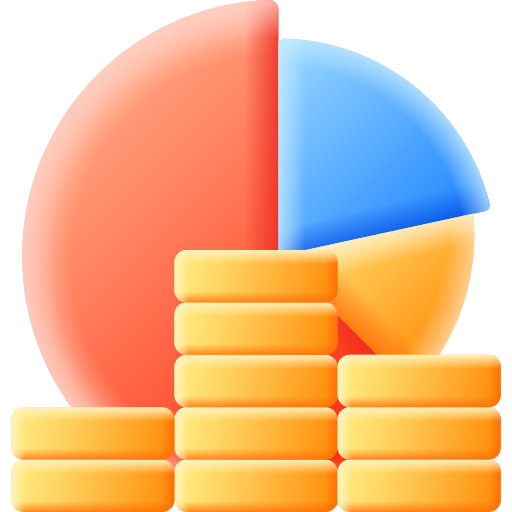
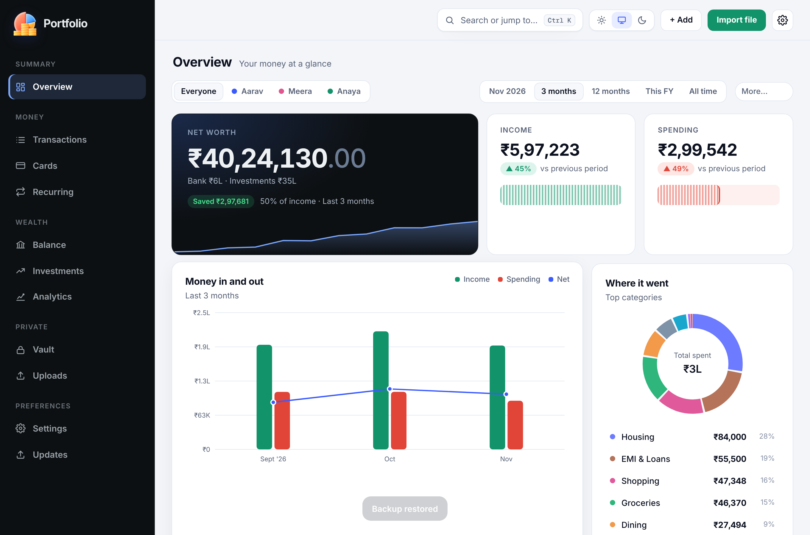
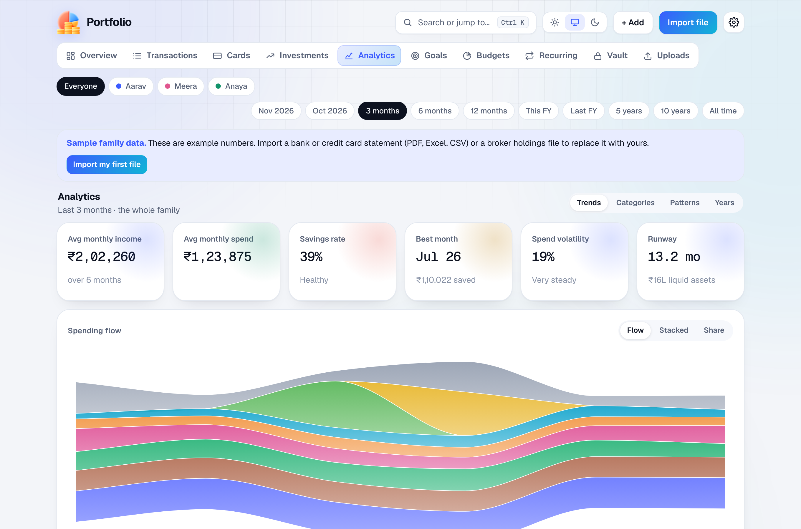
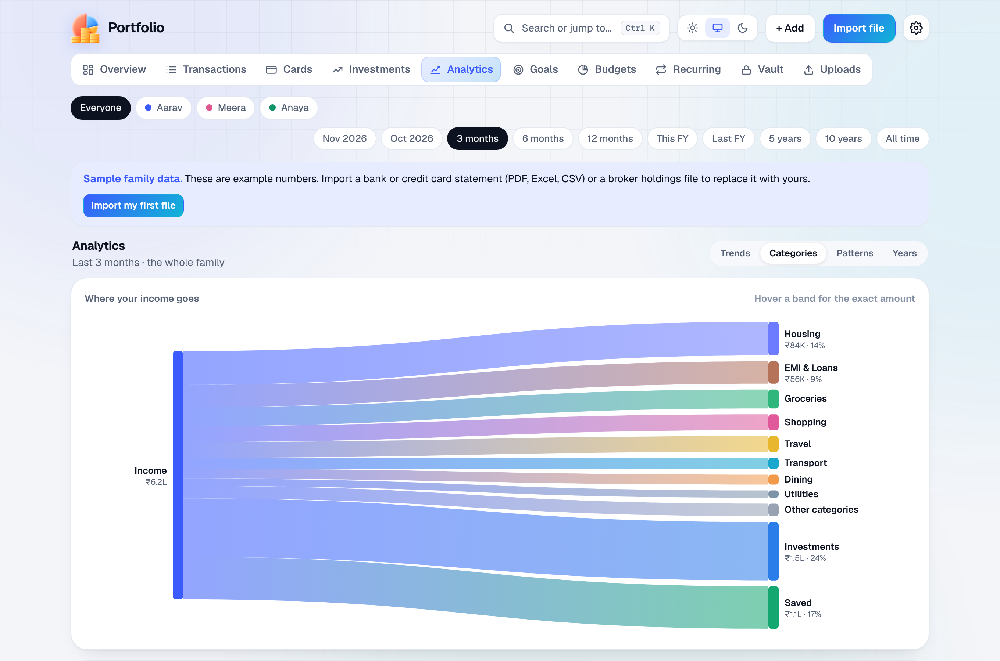
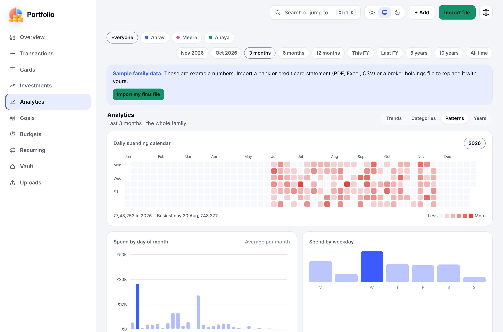
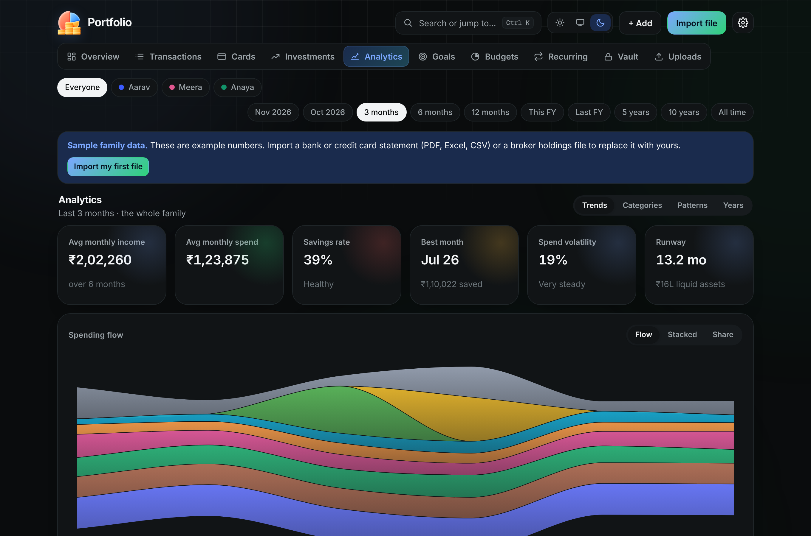
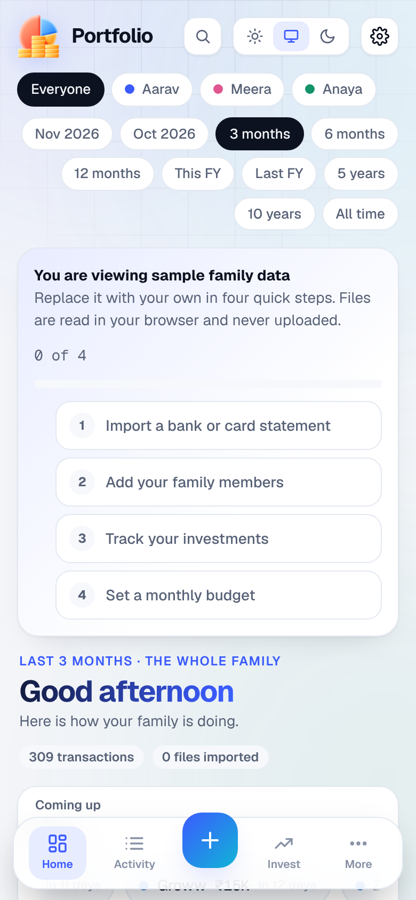
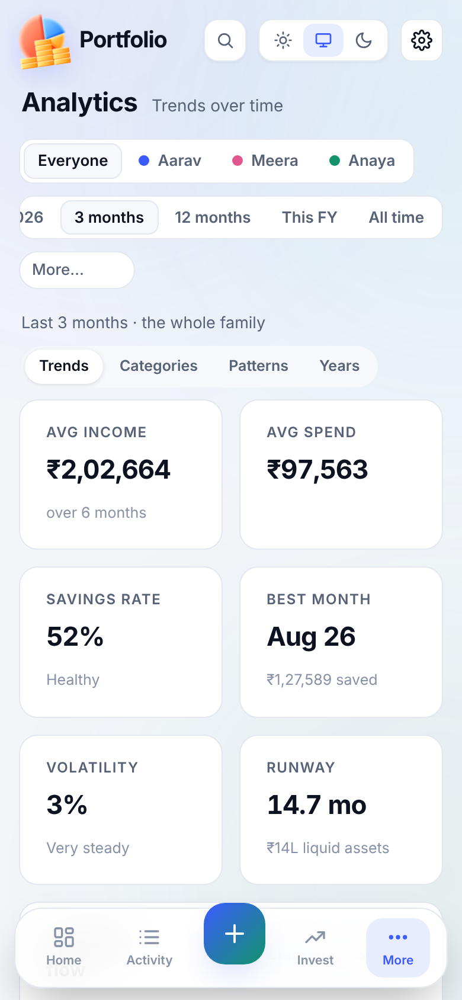
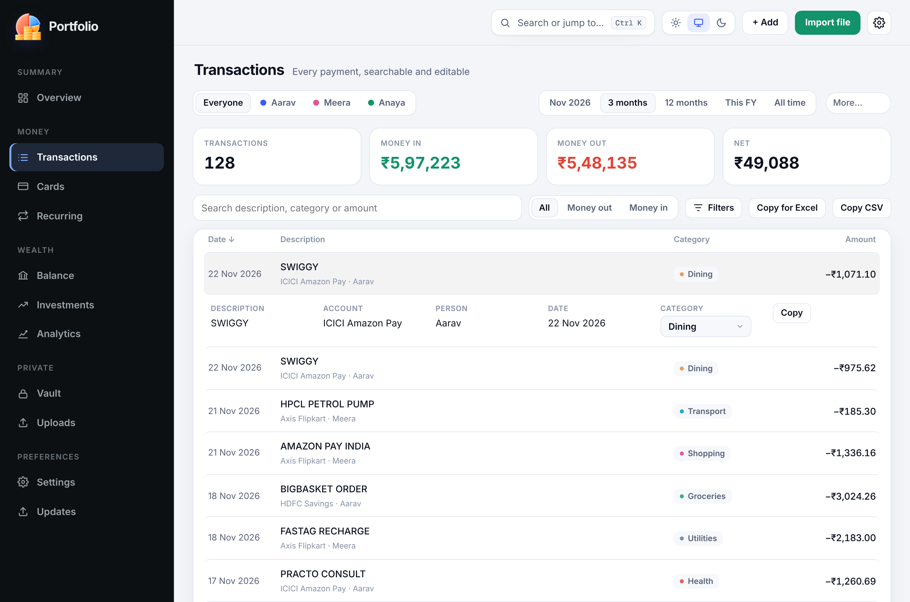
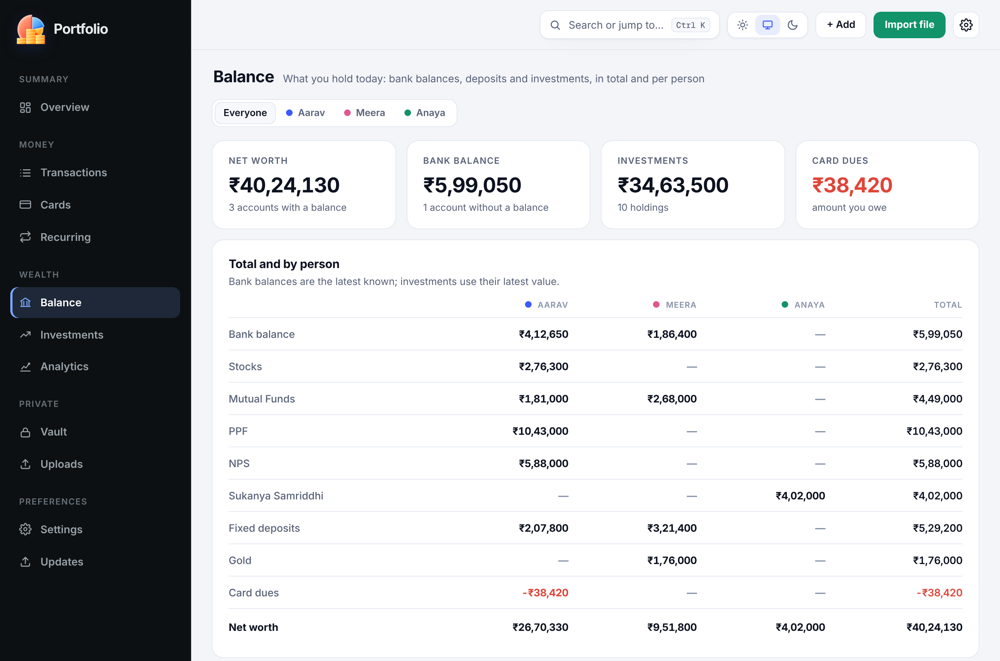

<p align="center"></p>

<h1 align="center">Portfolio</h1>
<p align="center"><b>A private money dashboard for Indian families.</b><br>
Upload bank and credit card statements, see where the money goes, track balances and investments.<br>
No server. No database. No tracking. Your data stays in your browser.</p>

<p align="center"></p>

## Features

| | |
|---|---|
| **Import anything** | PDF (including password-protected), Excel, CSV/TSV, OFX/QFX. Broker and fund holdings files update Investments. |
| **Never double counts** | File fingerprint plus row-level matching skips duplicates. An upload log shows what each file added and lets you remove it. |
| **Ten years and more** | IndexedDB storage, yearly roll-ups and FY ranges keep it fast with tens of thousands of rows. |
| **Family** | Members, accounts, credit cards with limits and utilisation, per-person views. |
| **Analytics** | Spending flow, income-to-spend Sankey, merchant treemap, daily calendar, year-by-month heatmap, year-over-year lines, savings rate, 3-month outlook, unusual payments, category growth. |
| **Investments** | Stocks, mutual funds, PPF, EPF, NPS, Sukanya Samriddhi, LIC, FDs, gold, with annual limit trackers. |
| **Balance** | What you hold today: bank balances and other holdings, as a total and per family member. |
| **Bills** | Recurring payment detection and upcoming bills, transfer matching between your accounts. |
| **Vault** | Card, account, PAN, Aadhaar and policy numbers. Last four characters show, the rest after you click Reveal. One-click copy. |
| **Copy anything** | Every transaction can be copied; copy a whole filtered list for Excel or as CSV. |
| **Data safety** | Every save keeps a mirror copy, the previous version and a daily snapshot, and the app offers to restore them if the main copy goes missing. Another tab can never overwrite newer data. Persistent storage is requested; a banner appears if a save fails. Back up from Settings anyway. |
| **Updates** | An in-app Updates page installs new GitHub releases onto your own site (needs `update.php` from the release page). |
| **Themes** | Light, dark and system with an animated reveal. |

<p align="center">




</p>
<p align="center">




</p>

## Install on cPanel (shared hosting)

You need a domain with cPanel. About five minutes.

1. **Get the files.** Download `portfolio-vX.Y.Z.zip` from the latest [release](../../releases). It already includes `.htaccess`. (Or run `./scripts/make-zip.sh` yourself.)
2. **Open File Manager** in cPanel and go to `public_html`. Create a folder, for example `finance`. (Use a subdomain's folder if you prefer `finance.yourdomain.com`.)
3. **Upload** the ZIP into that folder, then right-click it and choose **Extract**.
4. **Check the layout.** Directly inside the folder you should see `index.html`, `css/`, `js/`, `assets/`, `vendor/`. If there is an extra folder level, move the contents up.
5. **Security headers.** Copy `deploy/hosting/htaccess.txt` to `.htaccess` in the same folder (the ZIP from step 1 already has it). In File Manager settings turn on **Show Hidden Files** to see it. This adds a strict Content Security Policy, forces HTTPS and blocks search engines.
6. **HTTPS.** Open **SSL/TLS Status** and run AutoSSL for the domain. The passcode lock needs HTTPS.
7. **Visit** `https://yourdomain.com/finance/`.
8. **Protect it** (pick one or both):
   - In the app: **Settings, Security, Set a passcode.** Your data is encrypted on the device.
   - On the server: cPanel **Directory Privacy** to add a username and password to the folder.
   - Optional: Cloudflare Access (below).

To update later see [Releases and updates](#releases-and-updates). Your data lives in each browser, so it is untouched.

> The same steps are in the app under **Settings, Install & hosting guide**.

### Optional: Cloudflare Access

Cloudflare is not required. If you want a login in front of the site: **Zero Trust, Access, Applications, Add an application, Self-hosted**, enter your hostname and path, then add a policy allowing only your email addresses. A proxied DNS record is enough; a tunnel is not needed for a static site.

## Other ways to host

Everything is static files, so any host works. Ready-made configs are in [`deploy/`](deploy).

| Option | How |
|---|---|
| **Open locally** | Double-click `index.html`. Try `samples/hdfc-style-statement.csv`. The passcode lock needs HTTPS or `localhost`. |
| **GitHub Pages** | Run the **Deploy to GitHub Pages** workflow (Actions tab). A public repo means a public site, so set a passcode and keep your data out of the repo. |
| **Netlify / Vercel** | Import the repo. Publish directory is the repo root. `deploy/hosting/netlify.toml` and `deploy/hosting/vercel.json` add headers. |
| **Cloudflare Pages** | Connect the repo, no build command, output directory `/`. |
| **Docker** | `docker compose -f deploy/hosting/docker-compose.yml up -d --build`, then open `http://localhost:8080`. |
| **nginx / Caddy** | Serve the folder. See `deploy/hosting/nginx.conf` and `deploy/hosting/Caddyfile`. |

## Releases and updates

Versions follow [semantic versioning](https://semver.org/) and every change is listed in [CHANGELOG.md](CHANGELOG.md). Each [release](../../releases) has a ready-to-upload `portfolio-vX.Y.Z.zip` and its `.sha256`.

**Updating a hosted site** (pick one):

| Method | Setup | What happens |
|---|---|---|
| **Manual** | none | Download the new ZIP from Releases, upload and extract over the old files in File Manager. |
| **Automatic over FTPS** | In the GitHub repo: Settings, Secrets and variables, Actions. Add secrets `FTP_SERVER`, `FTP_USERNAME`, `FTP_PASSWORD`; variables `DEPLOY_FTP=true` and `FTP_DIR` (for example `public_html/finance/`). Use a cPanel FTP account limited to that folder. | Publishing a release uploads it to your site. |
| **One-click on the server** (also in the app under **Updates**) | Download `update.php` from the release page (a separate file next to the ZIP) and upload it next to `index.html`, once. Open the app, go to **Updates**, press Check, then Install and enter your Portfolio passcode. It needs the encrypted sync (`sync.php`) to have run once, because the passcode is checked against it. | The server downloads the latest release from GitHub, checks its SHA-256, backs up the old files to `.portfolio-backup/` and installs. It never touches your data, `sync-data/` or `update.config.php`. |

Your data lives in each browser and is never touched by an update. Open tabs notice a new version within seconds of loading (the app compares its version with the site's `version.json`, a same-origin request) and show a **Reload** prompt. **Settings, Check for updates** does it on demand.

**Publishing a release** (maintainers):

```bash
scripts/bump.sh 1.1.0                 # sets version.json, package.json and js/app.js
# add a "## [1.1.0] - YYYY-MM-DD" section to CHANGELOG.md, then
git commit -am "Release 1.1.0" && git tag v1.1.0 && git push origin main --tags
```

The **Release** workflow checks that the tag, versions and changelog agree, runs the tests, builds the ZIP, publishes the release with the changelog section as its notes, and deploys over FTPS if enabled.

## Security and privacy

- **Local only.** Nothing is uploaded. The app makes no network requests; fonts and the PDF/Excel libraries are served from this folder (`vendor/`, checksums in `vendor/SHA256SUMS`).
- **Encryption at rest (optional).** With a passcode, data is encrypted in IndexedDB using AES-256-GCM. The key comes from the passcode through PBKDF2 with SHA-256 (600,000 rounds). The passcode is never stored, so **there is no recovery**. Keep an encrypted backup.
- **Vault** values are masked on screen and need the passcode to exist; revealed values hide again after 15 seconds. Do not store CVVs or PINs.
- **Auto-lock** after inactivity; locking reloads the page so decrypted data leaves memory.
- **Strict CSP.** Only same-origin scripts, no inline scripts, no `eval`. All user text is escaped before display. Copied CSV/TSV is neutralised against spreadsheet formula injection.
- **Limits.** Anyone with your unlocked browser or a malicious browser extension can see what the page shows. A public site without a passcode keeps data in each visitor's own browser only, but the page itself is public.

## Development

```bash
npm install
npx playwright install chromium
npm run check   # syntax
npm test        # end-to-end: import, dedupe, PDF, XSS, 10-year load, encryption
node tests/screenshots.js   # regenerate docs/screenshots
```

```
index.html        page shell
version.json      current version (changes with every release)
CHANGELOG.md      release history
css/app.css       styles (themes, components, charts)
js/app.js         application
js/theme.js       sets the theme before first paint
vendor/           pdf.js, SheetJS, Inter and Geist Mono fonts (no CDN)
assets/           logo
samples/          example statements
deploy/hosting/   .htaccess, nginx, Caddy, Docker, Netlify, Vercel
deploy/php/       sync.php (encrypted sync), update.php (one-click updater), update.config.example.php
scripts/          bump.sh (version everywhere), make-zip.sh (release ZIP)
tests/            Playwright end-to-end tests (fictional data only)
docs/             NOTES.md (how it is built and why), screenshots/
CLAUDE.md         rules for working on this repo
.github/          CI, release, Pages, Dependabot, issue templates
```

CI runs syntax checks, verifies vendored files, blocks external URLs and unsafe patterns, scans for secrets and runs the end-to-end suite.

## Notes

Multi-account statements with Deposits / Withdrawals / Balance columns (tested on an ICICI annual statement layout) are reconciled against the running balance before import, and FDs and PPF in the file are added to Investments. Other layouts fall back to a generic line parser. PDF layouts vary a lot between banks. Always check the preview before importing. Scanned (image-only) PDFs cannot be read; use the Excel or CSV export from net banking instead.

## Credits

<a href="https://www.flaticon.com/free-icons/budget" title="budget icons">Budget icons created by Icon Place - Flaticon</a>

Fonts: Inter by Rasmus Andersson and Geist Mono by Vercel (SIL Open Font License). PDF parsing by pdf.js (Mozilla). Spreadsheet parsing by SheetJS.
